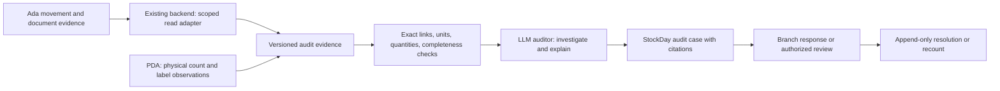

# AI auditor: Ada movement evidence and staff-observed lots

Implementation update: [audit-core delivery](PDA_AUDIT_CORE_DELIVERY_2026-11-04.md) now provides isolated cases, staff replies, raw-transfer input and blocked adjustment previews. Candidate lot links remain unconfirmed; live Ada access, scheduled execution and an official adjustment writer are still pending. Earlier proposal-only descriptions below remain historical.

Status: architecture proposal added on 4 November 2026. Continues the existing StockDay/PDA project. No runtime change, database connection, permission grant, LLM service activation, migration, deployment or official inventory write is performed by this document.

Execution clarification from the user: the first auditor uses an hourly Codex scheduled task under the existing subscription, with no external LLM API dependency. Preparing official Ada stock-count adjustment is a core deliverable. See [the execution and adjustment contract](PDA_CODEX_AUDIT_AND_ADA_ADJUSTMENT_PLAN_2026-11-04.md), [reviewable schedule configuration](../deployment/pda-codex-hourly-audit.review.json) and [task prompt](../deployment/pda-codex-hourly-audit.prompt.txt). These files do not create or enable a task.

## User requirement

The AI auditor must be able to investigate Ada source/destination transfers and related movement documents, including the evidence supporting ขย.9, ขย.10 and ขย.11 work. It must combine this with manufacturing identifiers/dates, lot numbers, expiry dates and quantities observed by branch staff. Supplier invoices/receipts may omit these fields entirely. Missing supplier fields must not prevent retaining useful physical evidence from the branch.

System quantities stay visible for branch replenishment. Count evidence, replenishment requests and official Ada adjustments remain separate operations. The auditor helps investigate; receipt of a count does not establish that an official inventory adjustment occurred.

## Evidence sources and provenance

| Source | Evidence to retain | Limits |
| --- | --- | --- |
| Ada purchase, sales, returns, transfers and adjustments | Source system/company/branch, stable document and line keys, exact SKU/barcode strings, original unit and verified factor if available, quantity, references, source/destination, document date, processing/cancellation state and actual stock-effect time when available | Document presence or approval is not proof of a stock effect or physical receipt. Missing times, unit mappings and incomplete sync remain explicit. |
| PDA branch observation | Existing event/receipt IDs, branch, exact product, chosen unit, physical quantity, lot/manufacturing identifiers and dates as supplied, explicit unknown fields, observed/captured/received times, operator/device, scope/round and correction lineage | A count establishes a physical observation at its observation time; it does not prove the lot's supplier, arrival date or current remaining stock. A shared account identifies the account/device, not necessarily a unique person. |
| AI or reviewer linkage | Evidence IDs and frozen versions, proposed document-line/lot connection, allocated quantity/unit, supporting references, missing/contradictory evidence, status, actor/time and superseding decision | Derived links are separately stored proposals/decisions. They do not rewrite the Ada document or the original count. |

Retain per-field provenance. Distinguish supplier-not-provided, staff-not-known, observed-from-label and conflicting evidence. Preserve original label text and date precision when supplied; never invent a manufacturing date from expiry or shelf life. If a manufacturing identifier and a lot number are separate on the label, retain them separately rather than assuming equivalence. A later correction links to the original evidence and records the reason.

Lot strings alone are not globally unique. Use stable observation IDs and product/manufacturer context where verified. The same lot can span several receipts and branches. A barcode does not establish pack identity; a missing conversion factor is not 1.

## Read architecture

The model accesses Ada evidence through backend read tools scoped to the approved audit case and user authority. Database credentials stay backend-side. Reuse approved existing read/sync paths when they meet the case's completeness/freshness needs. A synchronized Ada copy is usable evidence only with its source, coverage and lag shown; it is not represented as a fresh direct Ada query. A live read adapter remains pending verified connectivity, accepted contracts and any separately required access approval. No new persistent access is provisioned here.

Proposed tool operations, not claimed existing endpoints: retrieve bounded SKU/branch movement history; retrieve a document and its lines/status; retrieve source/destination transfer evidence and candidate pairings; retrieve staff lot observations and linked corrections. Each returns stable source keys, source version/observation times when known, extraction time separately, coverage and missing-data indicators. The LLM can follow references across branches within approved scope and cite every conclusion.

Exact document/line identity, original references, verified unit conversion and deduplication underpin linkage. Date/quantity proximity can nominate candidates but cannot prove identity. Handle split shipments, partial receipts, many-to-many allocations, returns, cancellations and reprocessing without allocating the same quantity twice. Inconsistent or multiple candidates stay unresolved for review. Calculations and bounds are deterministic; narrative plausibility does not establish a link.

## Lot lineage begins where evidence begins

Example, entirely hypothetical: Ada has transfer T-EXAMPLE from 000 to 001 for SKU X, quantity 10 in a verified matching unit, but no lot. At 001 staff observe lot L-EXAMPLE quantity 6 and lot M-EXAMPLE quantity 4, with label dates.

The auditor can report the transfer and both branch observations, and can propose the transfer as an origin candidate. Equal totals and nearby dates do not prove that both lots came from that transfer: there may be earlier stock or other receipts. A verified physical receipt linked to the specific transfer line can confirm the allocated lot quantities. Without that evidence the origin remains unknown/candidate even though the physical lots are known.

For better future lineage, capture missing label details once at a receiving or dispatch checkpoint that can identify the actual source document line. When physical identity is confirmed, the destination can confirm the inherited lot details instead of entering them again. Retain exception entry for mixed lots, partial delivery and damaged/missing quantities. Observations first discovered in a biannual count must not be backdated as receipt events.

An exact SKU movement ledger is not automatically a lot movement ledger. Where POS sales, transfers or adjustments lack lot identity, the system cannot claim exact remaining quantity by lot. FIFO/FEFO allocation would be an explicitly labeled estimate requiring a separate accepted policy. Show last-counted lot quantity/time and unallocated movements instead of presenting an estimate as physical fact.

## AI audit decisions and operating limits

Use three evidence states: supported by a verified link, candidate requiring confirmation, and unknown/contradictory. A confidence score alone is not proof. Each case records the exact evidence versions consulted, the model/run version, findings and citations, missing evidence, proposed next action, staff reply and final reviewer decision. Changes append a new decision and trigger review of dependent conclusions.

The AI should first ask whether a difference can be explained by unprocessed transfer evidence, partial receipt, units, missed storage points, returns or movements during counting. It must not infer theft, physical arrival, missing stock or operator dishonesty from document counts or numerical agreement alone. If post-count movements are incomplete, require a fresh count or human reconciliation before an official adjustment. Independent recount rounds are compared, never added. Zero remains distinct from not counted/unknown.

The counts in StockDay, branch replenishment requests and official Ada adjustments stay independently traceable. Approved correction of count evidence does not change Ada. Any future official adjustment requires the existing authorized process, a time-aligned reconciled basis, the applicable authority and its resulting document/receipt.

ขย.9/10/11 evidence uses the same underlying lineage where applicable, while preserving the accepted rules and review/sign-off of each existing document workflow. These labels are not presumed to be Ada transfer DocType values. AI case closure does not declare statutory-document completeness or substitute for authorized signing.

## Repository context reviewed; no new runtime verification

- Existing repository investigations document Ada transfer headers/details and processing status: [Ada investigation](adasoft/project_adapos_query_investigation.md). This is historical documentation, not a fresh database check; its aggregate counts and causal claims are not adopted as current case evidence.
- Existing design names raw transfer evidence and derived reconciliation cases: [preorder repository facts](CUSTOMER_PREORDER_SYSTEM_DESIGN.md). [Implementation notes](PREORDER_IMPLEMENTATION_STATE.md) distinguish outbound, processed/unprocessed inbound, ambiguity, unit mismatch and source staleness. These are useful reuse candidates, not proof of current deployment or a complete movement ledger.
- [ขย.9 document review](KY9_ADMIN_DOCUMENTS_REVIEW_20261024.md) describes a separate document register and review/signing states. Existing frontend regulated-drug catalog/helpers identify KY10/KY11 product groups; classification alone does not prove end-to-end document lineage.
- The user references `codex://threads/01a0eb19-f783-7472-8ae2-c69967b0b66f`. No cross-thread reader is exposed in this session, so that thread was not directly inspected. Its accepted contracts/owner decisions must be reused when available; no competing document owner or implementation is created here.

Next implementation proof, after contract/access acceptance: a sanitized synthetic transfer/receipt/lot case with both branches, one missing supplier lot, multiple candidates, a split receipt, a duplicate retry, a corrected lot and a movement after the count. Demonstrate supported/candidate/unknown separation and unchanged official stock. No such implementation or test run is claimed by this design update.
