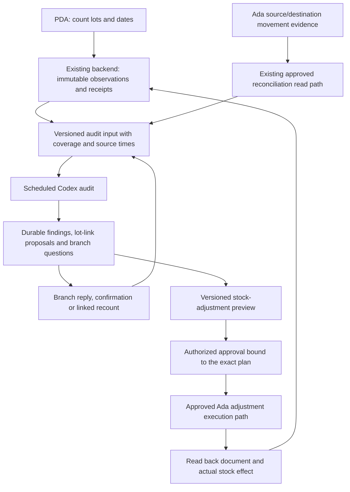

# Codex audit execution and official Ada adjustment preparation

Implementation continuation: [isolated audit-core delivery](PDA_AUDIT_CORE_DELIVERY_2026-11-04.md) supersedes the proposal-only status for case/input/reply/run-receipt APIs, UI and immutable blocked previews. Scheduler activation and the official Ada executor remain unimplemented/unapproved. The original proposal below is retained for context.

Status: reviewable integration contract, 4 November 2026. This extends the same PDA/StockDay project. It does not activate a scheduler, implement a new API, contact another owner, deploy, migrate, provision credentials or perform an Ada write.

## Accepted direction

The first AI auditor runs as a Codex scheduled task using the existing subscription, with no external LLM API integration required. The target cadence is hourly, `Asia/Bangkok`. Token/usage consumption is accepted by the user; this design does not assert unlimited subscription capacity, uninterrupted execution or a guaranteed completion time.

Official Ada adjustment is a **core PDA feature to prepare**, not an optional extension to omit. The current read-only auditor and current count-record receipt remain distinct from that future execution path. Preparing this path does not authorize production stock writes.

## One connected workflow

The backend supplies data, durable case state and execution receipts. Codex supplies investigation and recommended actions. No always-running LLM API service is needed for this arrangement. A paused/offline Codex task does not erase count records or block branch data entry; audit run time and case status remain visible. Replenishment requests remain independent and can use visible system stock with its uncertainty.

## Scheduled task preparation and actual admission

- [Schedule configuration](../deployment/pda-codex-hourly-audit.review.json): hourly exact cadence, Bangkok timezone, branch 001 and related transfer evidence, not created/enabled.
- [Ready-to-review task prompt](../deployment/pda-codex-hourly-audit.prompt.txt): one iteration, bounded reads, durable idempotent findings, preserved provenance and no official writes.
- The available automation discovery returned four tasks and no existing PDA/Ada audit task in that result. A paused SERVER004 check is a different task, and its returned environment list was empty. It was not modified. This is not proof that no native/local Codex automation exists outside the exposed list.
- The scheduler interface is available, but this session has no verified scheduled execution environment with Ada access. The current cloud workspace is not evidence of access to a branch POS server. No task was created with an assumption that access would work later.
- A shared production/staging audit-case/checkpoint/reply API and a corresponding authorized runner identity are not established. Existing isolated count receipts do not provide those contracts.

The smallest activation prerequisite is a verified existing execution target and authorized read path, followed by one bounded input-to-durable-audit-result run through the accepted contracts. This does not require an external LLM API key. It does require real access and a place for the durable result. The review files can be used by the existing local reconciliation owner/coordinator without creating a replacement owner.

## Shared contract with the existing reconciliation work

These are proposed contract fields/operations, not existing routes. Resolve them with the existing owner before implementation rather than inventing source semantics.

| Concern | Required agreement |
| --- | --- |
| Identity | Company/source system, branch/warehouse, exact SKU/barcode strings, canonical product/owner where verified; a transfer's source and destination scope |
| Units | Observed unit, approved canonical unit and conversion version; missing factors/pack identity stay unknown |
| Document evidence | Stable document and line identity, original references, direction, quantities, processing/cancellation state, effective stock time when known, source revision and source coverage/lag |
| Count evidence | Existing immutable event and receipt IDs, scope/session/category/round, lot rows, unknown fields, observer/device and observed/captured/received times; link to superseding correction |
| Lot linkage | Separate physical observation and document-line allocation; supported/candidate/unknown, evidence versions, allocated quantity/unit, reviewer and reason. One receipt can cover several lots; one lot can appear in several receipts |
| Case lifecycle | Open, waiting-for-branch, under-review, resolved/reopened; immutable findings/replies/decisions. AI can draft questions, but a real UI delivery/reply receipt is required before claiming staff were asked |
| Run/checkpoint | Stable run ID, bounded source window, source revision/checkpoints, incomplete pages, run lease, dedup key, input digest, accepted case receipts and committed checkpoint |
| Adjustment handoff | Frozen approved plan, current evidence/quantity preconditions, execution identity, vendor operation, stable external idempotency reference, verified Ada document/effect receipt |

Incremental work should include count corrections and source-document status changes, not just newly created documents. Use a bounded overlap for late records and validate complete paging. Do not advance a watermark before the corresponding result is durable. An existing case gets a new version when evidence changes; retries do not duplicate it. No branch lease/role/token format is invented by the task prompt.

Supplier omissions are retained as omissions. Staff label observations complement them with per-field provenance. Barcode-only movements cannot establish exact lot depletion. Existing ขย.9/10/11 owners retain document rules and review/signature authority; AI case resolution is not statutory approval.

## Official stock-adjustment contract to prepare

The old [transfer writeback specification](adasoft/project_adapos_writeback_implement_spec.md) proposes branch-local Type 4/7 transfer documents and explicitly excludes stock adjustment automation. It is useful architectural context but is **not** an implemented or accepted physical-count adjustment contract. Do not repurpose a transfer, receiving or Sync route as an adjustment. Its historical description of local SQL Server/AdaAcc connectivity must be revalidated with the actual Ada owner before choosing an execution target.

A stocktake adjustment plan should contain:

1. Stable proposal ID/version, branch/warehouse and exact product/stock-owner/unit identities.
2. Exact count event, scope, independent-round resolution, lot observations and complete physical coverage evidence. Independent rounds are selected/reconciled, never summed.
3. Effective count time, verified same-basis system quantity at that time, and complete deduplicated movements through the proposed execution cutoff, with source revisions and coverage. An old Full Sync number with unknown stock observation time cannot be the approved basis by itself.
4. Explicit vendor operation semantics: absolute physical-count posting or signed adjustment, rounding/precision rules, unit mapping and side effects. The actual document type/procedure, numbering, required fields and warehouse mapping are pending vendor/owner proof. No SQL or procedure name is guessed.
5. Human-readable before/after/delta at the same cutoff, reason, evidence citations, blockers, plan digest and expected revisions. A later count correction, source revision, relevant movement or document-state change invalidates an approval based on the previous plan.
6. Authorized approver identity/time bound to that exact digest and a short validity rule accepted by the owner. Existing count-save confirmation does not confer this authority.
7. Stable execution idempotency key, claimed job identity, expected branch/environment, attempt state and resulting Ada document reference. Approval identity is not supplied by the LLM as trusted input.

Example: count 3 at 10:00, then one verified sale before approval, gives a physical projection of 2 at the later cutoff only if the intervening movement stream is complete. The writer must execute the accepted vendor operation against a freshly verified same-basis state; it must not set the later stock to 3 or apply both an absolute posting and the same delta. Incomplete movement or unknown unit mapping blocks execution and requests a recount/reconciliation.

If Ada cannot store per-lot fields through the accepted adjustment path, keep the physical lot/date evidence and document allocation in StockDay with the returned Ada SKU-level adjustment reference. Do not claim that lot balances were updated in Ada when only SKU quantity was changed.

Proposed execution states: prepared -> awaiting review -> approved -> executing -> awaiting verification -> verified. Also retain blocked, rejected, superseded and execution-uncertain outcomes. If a request times out after a possible write, look up its stable external reference before retrying; uncertain does not mean failed-to-write. The original job must not be replayed as a new document. Header existence alone does not establish stock effect: verify posted status, exact lines/units/quantities and the applicable stock-ledger effect, then record the receipt. Corrections to executed operations require the approved compensating workflow, not erasure of old documents.

## Work packages and evidence needed next

1. Accept the joint read/count/lot-link/case contracts with the existing reconciliation and Ada owners; obtain a verified execution target without expanding access.
2. Implement a versioned audit input/result adapter and durable case/reply/checkpoint operations in the existing backend, using existing auth boundaries. No LLM API integration is needed. Isolated tests must prove duplicate runs do not duplicate cases and that replies/corrections reopen dependent findings.
3. Exercise one bounded Codex run against synthetic fixtures, then the approved reachable environment with real read-only evidence and accepted durable audit output. Only then enable one hourly task. Do not modify the separate Hourly/Transfer Delta jobs.
4. Implement an adjustment preview/job contract with an execution adapter that starts in validate-only mode. Prove the actual Ada physical-count/adjustment operation in an approved sandbox/vendor test environment; verify its stock effect and uncertain-outcome recovery.
5. After the concrete preview, contracts and sandbox evidence are reviewable, obtain only the separately required production deployment/schema/authority approvals and perform branch-001 live acceptance. No production write is authorized by this preparation.

## Delivery status for this update

Prepared: integrated architecture, explicit core adjustment milestone, common-data contract, reviewable hourly schedule configuration and executable-task prompt, exact activation and vendor-contract gaps. Checked: referenced repository documents and available automation discovery; schedule JSON/prompt/link consistency can be checked locally. Not implemented by this update: audit-case API, runnable Ada adapter, writer, scheduler activation or live roundtrip. No unrelated automation, source repository, auth/CORS, stock database or hosted version was changed.
