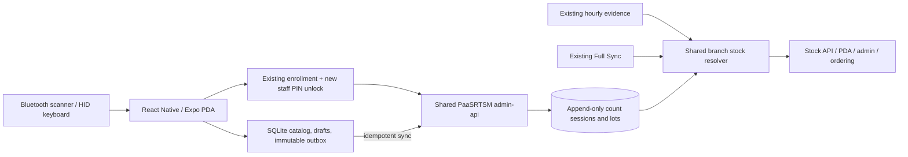

# PDA stock count — repository review and implementation design

Date: 2026-10-31. Status: architecture proposal + working, isolated browser preview.

This work implements a reviewable preview, not production authentication, a native application, a stock API, or a database migration. No live inventory, AdaAcc, Render configuration, or credentials were changed. The preview stores synthetic records in the visitor's browser and simulates synchronization. The source policy module is a reference implementation; no existing stock reader imports it.

## Requirement and relationship to the earlier design

Current request: a smartphone with a Bluetooth barcode scanner; staff record branch stock, manufacturing lot, manufacture date, and expiry date; valid staff counts become the primary stock evidence; hourly is the fallback and retains its own fallback; three simple accounts with four-digit PINs; interactive preview.

The June advisory, `architecture-assessment-and-mobile-pda-design.md`, chose React Native in a separate repository and a periodic expiry survey rather than an ERP lot ledger. Retain native app isolation and the survey limitation. The new request adds **complete physical counts** alongside **partial expiry surveys** and proposes a PIN-based login experience. Earlier person-lite/QR notes are context, not confirmation of the new PIN implementation. No full lot ledger or automatic FEFO sales allocation is implied by this request.

## Findings verified in current source

Review snapshots:

- SC-StockDay-Ordering: `e1f236d20b79ce2bab814ba770be7e61eb7822f8`.
- PaaSRTSM-project: `40ef239a43b7ba2104376aad296242b062ba28d1`.
- Source review only: production flag values, schema migration state, hardware behavior, and actual data completeness were not queried.

| Evidence | Consequence |
|---|---|
| `apps/admin-web/src/BranchStockPanel.jsx` and `apps/order-web/src/lib/api.js` call a configured backend | Put production stock policy in the shared API, not only inside the PDA client or an individual UI. |
| `PaaSRTSM-project/apps/admin-api/src/server.js` mounts mobile enrollment and mobile products at `/api/mobile` and products also at `/api/pda` | Extend this backend. Do not add a third implementation to the legacy SC `server/`. |
| `PaaSRTSM-project/migrations/038_add_mobile_enrollment.sql`, `routes/mobile-enroll.js` | Existing branch roster, single-use enrollment codes, short-lived enrolled devices, revocation, sales/manager roles can be reused. This is not yet a four-digit PIN login. |
| `PaaSRTSM-project/apps/admin-api/src/routes/mobile-products.js` | Existing exact barcode read joins `ada.product_barcodes`, `ada.products`, branch snapshots, effective prices. It currently reads snapshot stock, so it must be adapted to the same resolver as other stock consumers. |
| `SC-StockDay-Ordering/server/src/routes.js`, `/api/pda/products/scan` | Separate opaque branch-token scaffold primarily serves pricing. It is not the production PIN/enrollment architecture. Do not ship long-lived branch tokens in the new app. |
| `apps/adapos-sync/src/hourlyStockRunner.js` and `hourlyStockDerivedSource.js` | Hourly evidence already has outbox delivery and derived observations. The derived adapter currently permits branch 004 only; unverified observations must not silently become confirmed stock. |
| `PaaSRTSM-project/apps/admin-api/src/services/hourly004StockDisplay.js` | Read projection chooses eligible hourly display data or Full Sync; cohort, day, source timing, and Full Sync recency are checked. It explicitly reports unverified consistency and business freshness. Preserve those qualifications. |
| `apps/admin-web/src/lib/stock004DisplayView.js` | Known-only, unverified, and historical reference quantities have different semantics. A PDA feature must preserve those distinctions. |

The fallback chain is therefore **not** a new writer that overwrites Full Sync. It is a shared, versioned read projection over independently retained evidence.

## Proposed architecture



Native production client: use the previously selected React Native/Expo in an isolated repo, with screens/components separated from domain rules and an API adapter. Use SQLite transactions for drafts/outbox and platform Keychain/Keystore for credentials. Keep catalog and barcode/unit maps locally for offline lookup. A PWA remains a viable later alternative for keyboard-only use, but this preview is not a decision to replace the earlier native choice.

### 1. One count is an observation, not a stock adjustment

A complete count covers **one canonical stock item, one branch, every lot and every physical storage point**, including shelf/backroom. Sum canonical quantities for the count total. It is an absolute observed quantity, not a delta to add to hourly.

- `complete_product`: may become stock evidence after server acceptance and validation.
- `partial_lot_survey`: records expiry/lot evidence but never replaces the branch total.
- Explicit zero is valid. Missing data is `null`, never zero.
- Multiple lots with different expiry dates are valid. Exact duplicate lot/date identities must be merged or rejected.
- Count and expiry events are immutable; correction adds a superseding event with reason and actor.
- An offline draft or a local pending receipt is not server-accepted evidence.
- A barcode may represent a pack, a unit variant, or an alias to a shared stock code. Resolve product, canonical stock code, unit factor, and catalog revision before aggregating. Do not count sibling SKUs twice. Quarantine ambiguous or changed unit maps; never guess conversions.

### 2. Source selection and the meaning of “current”

The authoritative physical fact is **what was counted at the count time**. It is not automatically the present available quantity: sales, receipts, returns, transfers, reservations, and adjustments can occur afterward.

For the initial release, expose `observedQuantity` and `observedAt` clearly. A count can lead the reference display when complete, accepted, fresh, correctly scoped, conflict-free, and not superseded. Without a complete movement stream, a newer valid machine observation invalidates its priority. Keep the old count in history.

To use a count as an ongoing current-stock anchor, later compute:

`projectedStock = acceptedCount + completeSignedMovementsAfterCount`

Only enable this when the movement source has a verified watermark, no missing events, stable unit mapping, reversal handling, deduplication, and a defined count cutover. Neither subtracting two unrelated hourly quantities nor seeing unchanged repeated reads proves this completeness. On gaps, select the next eligible source.

Proposed shared resolver order:

1. Valid physical count / verified count-based projection.
2. Existing hourly projection, retaining existing cohort, branch, timing, and uncertainty rules.
3. Eligible Full Sync, with its actual per-branch observation time.
4. Unknown current quantity; optionally a separate stale historical reference, never reintroduced as confirmed quantity.

Return provenance, not just a number:

```json
{
  "branchCode": "004",
  "productCode": "DEMO-001",
  "quantity": 22,
  "quantityKind": "observed",
  "source": "physical-count",
  "observedAt": "2026-10-31T03:00:00Z",
  "receivedAt": "2026-10-31T03:01:00Z",
  "confidence": "counted-at-time",
  "validUntil": "2026-10-31T07:00:00Z",
  "eventId": "count-event-uuid",
  "revision": 12,
  "fallbackReason": null,
  "policyVersion": "pda-count-v1"
}
```

Preview policy values (proposals, not current production settings): count 4 hours, hourly 90 minutes, Full Sync 24 hours. An eligible machine observation newer than the count demotes the historical count even inside its 4-hour limit. The preview deliberately models reference stock; it does not promise available-to-promise inventory.

Production thresholds should be branch-configurable and validated against trading hours and actual posting behavior. Do not remove current hourly qualification rules just because the preview uses simplified eligible mock rows. Initially pilot branch 004; other branches fall back to their existing verified source rather than implying hourly support.

Existing Shopee/reservation and transfer projections need an explicit composition order: on-hand source selection first, then the established reservation/availability projection exactly once. Never subtract reservations from an observation already net of them. Quantities marked unknown/known-only/stale by that projection must remain so. Existing purchasing/recommendation consumers should adopt the policy through an explicit feature flag and equivalence checks, not via accidental changes to legacy fields.

### 3. Data and transaction model (proposed, no migrations created)

Use the shared production database, under the established inventory/ordering ownership:

- `count_sessions`: UUID, branch, staff, enrolled device, canonical stock item, source barcode/unit/factor and catalog version, scope, started/completed/observed/received times, absolute total, base revision, policy version, correction reference.
- `count_lots`: session ID, lot code nullable + unknown reason, quantity in canonical numeric unit, manufacturing date/expiry data and precision, original label text, optional location, explicit missing-data reason.
- `count_receipts`: unique `(branch, device, client_event_id)`, request hash, stored response. Same ID+same payload returns the same receipt; same ID+different payload returns 409.
- `count_projection`: branch + canonical stock item, monotonic revision, accepted event ID. Derived/materialized pointer only; raw evidence is retained.
- `staff_pin_credentials`: existing staff ID, PIN hash + server-side pepper version, active/disabled state, retry/lock metadata. Reuse existing roster and sales/manager authorization roles.

Create session, lots, receipt, projection revision, and required audit event in one database transaction. Use optimistic compare-and-swap on the branch/item revision. Two counts based on the same revision must not silently overwrite each other. Preserve the losing submission as pending review/conflict evidence and make the user resolve or recount; never auto-average or add totals.

The API derives actor and branch from the verified enrollment/session. It rejects spoofed actor, branch, total, unit conversion, out-of-scope device, revoked device, duplicate altered payload, and invalid chronology. Recalculate totals on the server using decimal arithmetic. All mutations require existing auth/CSRF protections appropriate to their transport.

### 4. Dates and expiry

Store exact dates as date-only, not a timezone-shifted midnight. Store observed/received timestamps as UTC and render in Asia/Bangkok. A label containing only `MM/YYYY` must retain month precision and original label text; do not invent a day. Proposed fields include `expiry_precision = day|month|unknown`, date/month values and label text. Alert calculations can use an explicit conservative month rule without presenting that as an exact printed date.

An unknown manufacture date is legitimate only when explicitly indicated, not silently defaulted to today. Expiry before manufacture is rejected. Expired items may still be counted and must be flagged for operational handling, not prevented from being recorded. Expiry surveys remain historical evidence because AdaPOS does not yet decrement stock by lot. Do not claim FEFO remaining quantities, automatic disposal, or supplier-return execution.

### 5. Offline and concurrency

On save, atomically write an immutable event + outbox entry in SQLite. Show `saved on device`, `pending`, `accepted`, `needs review`, or `failed`, with actionable retry. Persist before showing success. Keep account/branch attribution from capture; switching users must not relabel existing queued work.

Replay the original event ID and capture time. A late upload must not gain freshness from its upload time. Server validates observed time against enrolled-device clock evidence and reasonable future skew; untrusted clocks, missing catalog mapping, expired/revoked enrollment, or conflicting revision quarantine the event for review. Do not mark it accepted just because HTTP delivery succeeded.

Use a transactional outbox worker with bounded retries/backoff, network restoration handling, and per-branch/item serialization. Preserve draft and queue across process restarts. Background sync on iOS is opportunistic; foreground resume must flush visibly. Authentication expiry leaves the event pending until reauthentication or explicit review; it must not discard counts.

### 6. Three accounts and four-digit PINs

Preview accounts all belong to demonstration branch 004:

| Account | Preview PIN | Production role mapping |
|---|---|---|
| staff01 / พนักงาน 01 | 1111 | existing sales |
| staff02 / พนักงาน 02 | 2222 | existing sales |
| lead03 / หัวหน้าสาขา | 3333 | existing manager |

These PINs are intentionally public demo fixtures in a static browser preview. They provide no real access control. No production staff accounts were created.

Production proposal: retain one-time manager enrollment of a device, then let staff select their identity and enter a 4-digit PIN. Keep enrollment separate from daily PIN unlock; a 10,000-combination PIN alone must not authorize arbitrary Internet clients. Store only slow PIN hashes with server-side pepper; verify on server, issue short-lived, branch/device/staff-scoped credentials, support immediate revocation, and store native tokens only in secure storage. Never reuse POS/PDA branch tokens as staff PINs.

Enforce retries per account/branch/device plus an IP abuse limiter: proposed 5 failed attempts -> 15-minute server-side lock, increasing cooldown, manager reset, no PINs in logs. Browser preview has only illustrative in-memory throttling. Production retry state cannot be reset by restarting the phone. Use native idle lock, session expiry, and explicit account switching. Offline PIN unlock should only resume an already enrolled, time-bounded device session, not provision identities or mint server acceptance. Deny cost/wholesale views for sales using existing backend permissions.

If the 3 accounts are shared rather than individual people, audit can identify only the shared account/device. Provide a per-person name selection if individual accountability is needed; do not represent shared credentials as personal attribution.

### 7. API boundaries (proposed)

Reuse exact barcode endpoints in the shared admin API and mobile enrollment. Add narrowly scoped routes only after checking existing endpoint naming and client compatibility:

- `POST /api/mobile/auth/pin`: enrolled-device + staff selection + PIN; rate limited, no client-specified scopes.
- `GET /api/mobile/catalog?...`: bounded incremental catalog/barcode/unit map for offline cache.
- `GET /api/mobile/stock/:productCode`: same resolver + source metadata used by admin/order consumers.
- `POST /api/mobile/count-events`: idempotency key + immutable count event + expected item revision. Server-scoped branch, server-recomputed total. Returns receipt, acceptance status, revision, and conflict details.
- `GET /api/mobile/count-events?...`: branch-scoped history/sync status.
- `POST /api/mobile/count-events/:id/corrections`: scoped superseding correction with reason; no silent history edit.

No stock writes to AdaAcc, no vendor update procedures, no new live service until the shared API design is implemented and tested. No database credentials or service tokens in the mobile bundle.

## UI and preview delivered

`apps/pda-preview/` is a buildless HTML/CSS/ES-module prototype, isolated from all existing apps, backend routes, and root workspace scripts. No added runtime dependencies.

- Thai responsive dashboard, usable at 390 px; primary scan input and thumb-accessible mobile navigation.
- Account picker with 3 PIN fixtures. Account attribution saved with each event.
- Exact barcode + Enter (HID keyboard); synthetic sample button; typed exact product-code fallback.
- One product at a time, multiple lots, explicit unknown dates, quantity stepping, complete/partial scope, explicit zero, dirty-form discard protection.
- Local persistence, offline simulation, immutable events, mock sync receipts, item revisions and conflict retention. Mock sync never sends API requests.
- Source metadata, unknown-state display, configurable demo scenarios for fallback, history and JSON export.
- Browser validation, source-policy tests and QA flow script. Actual Bluetooth pairing, device hardware behavior, native secure storage, cross-device sync and real server auth remain unverified/unimplemented.

The prototype uses localStorage for review convenience; production must use the SQLite/outbox/server design above. The full preview JavaScript, including its PINs, is public to any visitor who can access it, so the hosted preview is owner-private and synthetic only.

## Implementation sequence

1. Review the workflow with staff on actual phone/scanner; verify Enter suffix, language, focus, pack units, month-only expiry, and typical counting duration. Finalize branch roles, names, account ownership, and freshness policy.
2. In the shared backend, implement count evidence/receipts/revisions and PIN/device constraints behind feature flags. Follow PaaSRTSM `AGENTS.md` migration numbering and production-migration rules. Do not migrate this SC legacy server for the new feature.
3. Build the isolated native app, SQLite catalog/outbox and server integration. Validate loss of connectivity, expired session, device revocation, simultaneous counts, altered retries, wrong units, and clock drift.
4. Pilot branch 004 with stock resolver in shadow mode. Compare selected source and fallback reasons with existing display without replacing operational quantities.
5. Enable source selection for reference display, then explicitly integrate other consumers after checking reservations/availability semantics. Roll back by feature flag to existing hourly/Full Sync reader; preserve all physical count evidence.
6. Add post-count movement projection only after proving completeness and cutover. A full perpetual lot ledger is a separate project requiring receiving and POS support.

## Follow-up: two-way comparison, confirmation and traceable corrections

User clarification during the review: a staff member may count 3 while the website shows 6 because stock exists on a second floor. They must see the discrepancy, recheck, explicitly confirm, and submit immediately when online. If they later find an omitted lot, they must be able to correct the submitted observation without erasing it. The original becomes evidence in a traceable incident/discrepancy report.

The preview now implements that flow:

1. At scan time, retain the reference quantity, source, observation time, retrieval time, branch and unit. The demo sample product shows website quantity 6.
2. Compare a **complete** product count to the latest available same-branch, same-unit reference at submission. Never compare a partial lot survey to the branch total. Unknown website quantity is not zero.
3. On any nonzero difference, show both values, signed difference, source and timestamp. Let the user return to the form, or explicitly attest to checking all storage points and enter a reason before sending. An explicit confirmation does not prove that either observation is objectively right; it records the user's checked assertion and allows the stated source policy to select it.
4. The mock sync rechecks the reference and revision. Confirmation is bound to the exact count, reference quantity, source and observation timestamp. If these change before acceptance, keep the submission as a review/conflict receipt and require rechecking instead of treating the old confirmation as blanket permission.
5. Confirmed online saves are immediately delivered to the simulated server path. Offline saves visibly remain pending with cached reference evidence; delivery does not reset the count timestamp. This is local simulation only, not a live StockDay API connection.
6. History exposes **Correct while retaining history**. It preloads the old lots, lets the user add an omitted lot and calculate the full corrected total, and requires a correction reason. The new event has a new UUID, `supersedesId`, `incidentId`, new actor/time and full corrected lot snapshot. It is a replacement observation, never an increment added to the old total.
7. Both records remain in history. The linked incident view shows before/after quantities, original actor/time, correction actor/time, reason and baseline evidence, with a link to the original record. Original counts, lots and comparison confirmations remain unchanged; an accepted correction makes the previous record historical. A pending, rejected or conflicting correction never removes the old accepted source.

A genuine receipt/delivery after counting is a new later count or a verified movement, not a correction claiming the earlier physical count was mistaken. If a correction refers to what was physically present at the earlier time, preserve that effective observation time separately from the correction's entry time and re-evaluate source freshness; never refresh an old observation by editing it. The preview treats correction as a fresh recount of the full product and records the original observation link.

Production must implement the comparison, confirmation binding, receipt idempotency, correction lineage validation, immutable incident evidence and optimistic concurrency **server-side in a single transaction**. No new manager approval gate is assumed: the clarified workflow lets staff explicitly confirm after rechecking. Existing role/branch restrictions still apply, and managers can inspect incident reports. A receipt proving successful transmission must remain distinct from acceptance as the selected stock source.
