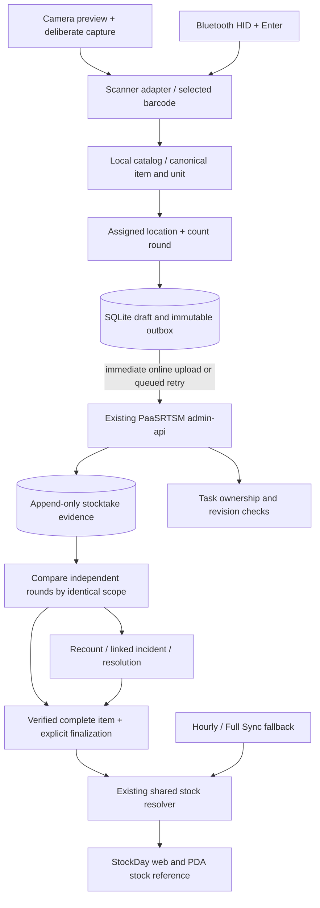

# Practical architecture for the upcoming team stocktake

> Current integration update: an isolated synthetic HTTP/SQLite count demo is now implemented. See [PDA_DEMO_INTEGRATION_CONTRACT.md](PDA_DEMO_INTEGRATION_CONTRACT.md) and [PDA_DEMO_INTEGRATION_STATE.md](PDA_DEMO_INTEGRATION_STATE.md). This does not implement remote staging, production stock writes, or team floor/round sessions. Earlier preview-only statements below describe the earlier milestone.
Date: 2026-10-31. Status: implementation proposal. Camera scanning and individual-count correction flows are implemented in the isolated browser preview; shared multi-phone stocktake sessions are not implemented yet. This document does not authorize or perform production database changes.

## The core rule

**Add locations; compare recounts.**

- Floor 1 contains 3; floor 2 contains 3 -> branch physical quantity is 6.
- Counter A says floor 1 contains 3; counter B independently says floor 1 contains 3 -> floor 1 quantity is 3, not 6.
- Counter A says 3; counter B says 4 in the same location -> no automatic winner or average. Require an independent exception count/reconciliation.

A quantity is identified by **session + branch + location + canonical stock item + lot + unit + count round**. A bare barcode/quantity pair is insufficient for team counting.

## Recommended initial operating method

1. Pick a small pilot zone with real shelf labels, not the whole shop at once. Create a branch stocktake session with a defined stock cutoff and a short list of locations: floor 1 shelf A, floor 1 backroom, floor 2 shelf A, and so on.
2. Assign each area/round to one counter. Two phones must not unknowingly own the same first-count task. The UI always shows branch, physical area and round.
3. Round 1: scan, confirm the product, enter the quantity or per-lot quantities, save, next product. Drafts save locally; confirmed submissions are sent immediately when online. A receipt reports that the server stored the evidence; it does not say that the branch stock changed.
4. Round 2: a different person counts the same scope **blind**, without seeing round 1 or the website quantity until their submission is locked. For the first pilot, double-count the whole small zone. At branch scale, a later policy can focus round 2 on discrepancies, high-value/expiry-sensitive products and a random quality sample.
5. If rounds agree and all required locations are accounted for, the item is verified. If they disagree, assign a targeted third count. A third count is additional evidence, not a majority-vote overwrite: a stocktake lead reconciles location coverage, unit conversion, lots and movements and records the resolution reason.
6. Compare the verified branch total with the retained website reference at a comparable cutoff. Show website 6 versus verified 3, source/time, signed difference and coverage. The lead investigates or explicitly accepts the variance. Record both the observation and its decision.
7. Finalize verified items through the existing shared backend. Unresolved, incomplete or out-of-time items remain exceptions and retain the existing stock source. Do not turn missing counts into zero.

The session lead's finalization is an operational control for a coordinated batch. It does not add a new manager-approval requirement to the existing ad hoc workflow, where staff can recheck and explicitly confirm a full product count.

## Phone UX: one obvious next action

The working screen should emphasize tasks, not an analytics dashboard:

```text
Branch 004 / Floor 2 / Shelf A / Round 1
Assigned to: Counter 01                   12 items recorded

[ Scan with camera ]    [ Bluetooth / type barcode ]

Product: ...
Unit: bottle (canonical unit shown clearly)
Lot A: [3]     Lot B: [0]     [+ Add lot]
Total in THIS LOCATION: 3

[Save & next]
Saved on device -> Sending -> Server receipt
```

After saving, give a brief visual receipt and focus the scan input again. For camera use, reopen the aiming screen only after the user chooses the next scan. Never increment a quantity just because a scanner repeats a barcode. Rescanning an item already entered in that task opens its existing entry and offers a linked correction; it must not silently create a second additive row.

Stocktake screen states: not started, draft, saved on device, awaiting upload, received, submitted/locked, needs recount, verified, finalized. Show unsent/failed counts persistently. Staff must not mark an area complete while it contains unsent or unresolved entries.

Blind count screens withhold expected quantities until submission. Afterward show comparison evidence appropriate to the scope. An area count of 3 must not be labeled a discrepancy against the whole branch's 6 before the other areas are complete. Managers can inspect the website reference and discrepancy queue throughout.

Lot detail should not make every checker retype long descriptions. Round 1 records product/lot identity and printed dates; independent quantity checkers identify and verify the actual lot, rather than inheriting a quantity to agree with. Cache product identity/unit maps. Provide explicit unknown-date/unknown-lot cases for review; never default dates to today. Preserve day/month/unknown precision in production. All-location totals sum canonical quantities for the same canonical stock item, with ambiguous shared-stock aliases held for review.

## Architecture: one shared backend, separate evidence and publication



Do not put a second stock ledger in the SC legacy Express server or a new disconnected database. Use the existing production API in `PaaSRTSM-project/apps/admin-api`, mobile enrollment and branch-scoped identity. The Android native app remains in a separate repository, as already proposed. The existing web apps and PDA should read the same resolver/provenance contract.

### Practical module boundaries

- **Scanner adapters:** Camera, Bluetooth keyboard/HID and typed lookup produce the same product-selection event. They never write stock. A scan identifies a product; a count submission records quantity.
- **Count task controller:** owns session/area/round, lot rows, unit normalization, explicit completion, correction lineage and UI state.
- **Local persistence/outbox:** SQLite transaction before success, immutable client event ID, original observation time, scoped device/staff identity, persisted retries. In the current browser demonstration this is localStorage; that is not suitable as the shared multi-phone authority.
- **Mobile API:** existing authenticated backend; branch/actor derived server-side. Validate active task assignment, location, count round, expected revision, canonical units and data types.
- **Evidence repository:** append-only observations, receipt idempotency and linked correction/incident evidence. Separate received, verified and finalized states.
- **Reconciliation service:** compare the same item/location/lot/round scope; identify missing coverage, duplicate submissions and conflicts. It does not select winners by latest phone clock, majority vote or average.
- **Publication service:** finalizes a complete accepted branch/item observation and records the evidence set and stock policy version. It never adds repeated counts together or writes to AdaAcc.
- **Shared read resolver:** finalized eligible physical evidence -> eligible hourly -> eligible Full Sync -> unknown. Continue existing source qualification, reservations/availability composition and historical-reference semantics.

## Minimal durable schema (proposed)

Use normal row keys, not per-floor columns. No migration is created by this design.

| Entity | Important fields |
|---|---|
| stocktake_sessions | UUID, branch, state, planned cutoff, location-set version, catalog/unit-map version, lead, started/closed times |
| stocktake_locations | session/location IDs, parent floor/zone, clear physical label, active coverage state |
| stocktake_tasks | session/location/round, assigned staff/device, assignment revision, state, lease/assignment metadata |
| stocktake_observations | event UUID, task, canonical item, raw barcode, observed unit/factor, quantity, staff/device, capture/received timestamps, revision, supersedes ID |
| stocktake_lots | observation, lot identity, date precision/original label, canonical quantity |
| stocktake_receipts | unique scoped client event ID, payload hash, durable receipt and validation outcome |
| stocktake_item_coverage | session/location/item completion and explicit-zero evidence; no missing-row-as-zero shortcut |
| stocktake_resolutions | evidence IDs, selected observation or new recount, actor, reason, before/after comparison, incident ID |
| stocktake_publications | session/branch/item, accepted evidence set, effective observation/cutoff, received/finalized times, policy version, supersession reference |

Separate a receipt proving transmission from verification/publication. An online save writes the observation, immutable audit event and receipt atomically. Finalization checks exact task revisions and coverage in a transaction. The losing concurrent submission remains evidence for review; it is not discarded and does not overwrite another counter.

The three simple staff accounts can participate in the pilot, but if several humans share an account, the audit identifies the shared account/device rather than a uniquely authenticated person. Prefer a named operator selection per enrolled device if shared accounts are unavoidable. Keep production PIN hashes, server-side retry limits, enrollment revocation and branch/role constraints from the earlier design.

## Concurrent counting and offline rules

Use **preassigned areas** for the first pilot. Online task claiming must be atomic and return an assignment revision. An offline device can continue only its downloaded assignment; it cannot claim arbitrary unowned tasks while disconnected. Another device cannot steal that task merely because a heartbeat expires. Reassignment is explicit, increments assignment revision and flags late uploads from the previous assignment for review.

A mobile event has a stable UUID and request hash. Same UUID + same payload returns the original receipt. Same UUID + different payload returns conflict. Enforce this on the server, not just in the phone. Do not treat a scanner's repeated Enter or a network retry as another count.

A later correction creates a new event with reason and a link to the original. If a counter discovers a second-floor lot omitted from a floor-1 task, put it in the correct floor-2 scope; do not quietly increase the floor-1 row. If they miscounted the original lot, correct that observation. A newly received delivery is a movement/later observation, not retroactive proof that the earlier count was wrong.

Changing an observation invalidates dependent second-count agreement and any verification built on that exact revision. A correction after finalization creates a reviewed superseding publication; it does not mutate the historical finalized session. Incident reports retain original count, website reference at the time, confirmation, correction, reason, actors/times, and resolution state.

## Counting while the shop is trading

The easiest reliable pilot is to count a small area while its stock is temporarily not moved, recording the start/end and cutoff. Coordinate sales picks, receiving and inter-floor transfers operationally. Close one area before reopening it.

If goods can move during counting, record those movements against a defined cutoff with a complete, deduplicated movement stream, or quarantine affected items for recount. Current hourly estimates are not proof of a complete after-count movement ledger. Do not normalize counts from different times by guessing, subtracting two estimates, or refreshing the observation time at upload. A sale between rounds can make two honest counters disagree.

Counted stock remains an observation at its effective time. Without verified subsequent movements, its display priority expires or is superseded according to the documented resolver rules. Reservations, sellability and damaged/quarantined stock remain distinct from physical quantity and must have a defined treatment in session scope.

## Camera architecture and the requested scanner-gun feel

The browser prototype now has a real local camera-decoding path and an explicit capture gate:

`closed -> opening -> aiming -> user capture -> decoding one frame -> product preview -> explicit product selection -> count form`

- While aiming, decoding is not called. There is no continuously accepted background scan.
- Crop the frame to the on-screen target, accounting for camera aspect ratio and `object-fit: cover`. Decode multiple symbols; refuse ambiguity rather than choosing a nearby code.
- A successful read beeps/haptics where browser support permits, stops camera/torch, and displays the barcode/product. Nothing is counted or saved by a decode.
- A failed or ambiguous frame returns to aiming for another deliberate tap. Double taps cannot run simultaneous captures, and a late decode cannot open a product after the camera is closed.
- Use the native BarcodeDetector API where operational; otherwise use bundled pinned zxing-wasm reader files. Decode locally; do not upload frames to a cloud decoder. Native Android production should use an on-device decoder such as ML Kit behind the same adapter contract.
- Turn on torch only when the track reports support; allow explicit off. No artificial projected laser. Stop camera tracks on close, success, backgrounding and app departure. Handle denied permission and camera-in-use states without losing the count task.
- The current preview supports an on-screen capture trigger. It does not claim to intercept Android volume keys. A separate native Android adapter should handle a non-repeating foreground `KEYCODE_VOLUME_UP`: closed -> open aiming/torch; while aiming -> capture on explicit trigger policy. Match the user's proposed open-with-Volume+, then tap-to-capture behavior first; a second Volume+ capture can be evaluated as an optional shortcut. Do not globally capture keys or trigger scans while editing quantities. Restore normal volume behavior outside scanner mode.
- Browser-generated camera frames and bundled sample images test decoder/control behavior. Actual camera focus, torch, volume keys, audible beep, vibration and comfort must be validated on the shop's phones.

## What to do before the upcoming count

The preview can be used immediately for **training and hardware/UX trials**. It must not be presented as a multi-phone production record: it has browser-local storage, demonstration PINs and simulated server receipts. It cannot currently coordinate staff, recover a lost phone's unsynced work centrally, or publish real StockDay stock.

Minimum operational pilot implementation:

1. Shared durable authenticated API storage for sessions, preassigned areas, immutable observations/corrections and idempotent receipts. Keep it isolated behind a pilot feature flag in the existing backend.
2. Live read-only catalog/units and website stock reference from that backend. Retain source timestamps/revisions; reference pulls do not authorize writes to existing stock tables.
3. Area/round UI with clear scope, blind second counts, exception queue and server acknowledgments. Keep lot/date collection and count entry short and test with actual staff.
4. Reconciliation/export first. For the initial real event, collect evidence and export a verified stocktake report while the established stock workflow remains authoritative. Enable publication only when end-to-end completeness, unit and timing checks have been tested.
5. Start with a small zone, two counters and one lead. Practice second-floor omission, duplicate barcode, box-versus-bottle, offline save, phone restart, changed task assignment, correction after submission, source discrepancy and sale during counting.
6. Confirm all task uploads and coverage, reconcile exceptions, then retain a session export and audit report. Produce separate lines for unresolved items; do not hide them in an apparently complete total.

Branch, date, team size/device count and Wi-Fi reliability remain open inputs. These change the rollout size and offline requirements, not the core evidence model.
