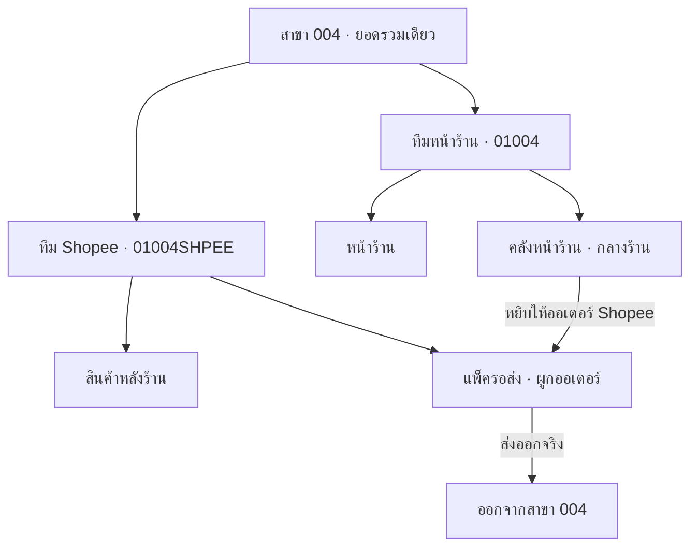

# Branch004 — separate teams, shared branch stock

19 November2026, PDA design checkpoint. The physical layout and workflow below
are user-confirmed. **R18 now implements and activates the model:** [release checkpoint](events/2026-11-19-pda-004-r18-area-release.md). Earlier readiness notes below retain their original pre-rollout time.
Preserve the R17 daily companion/Drive candidate and the independent Local Ada
product connector; this design does not replace either workstream.

## Confirmed shop layout

004 has a front sales floor, a front-team store in the middle of the shop, and
the Shopee operation at the back. The middle store belongs to the front team.
The teams normally count their own goods. When Shopee lacks goods, it may take
them directly from the front store to pack an order. This is still branch004;
there is no interbranch transfer-file exchange. Supply from001/003/005 keeps the
existing interbranch transfer process.

## Recommended first release

Keep one branch004 and one official Ada stock reference. Separate actor identity
from count scope; an account is not another stock balance.

| Login | Branch | Default count scope | Covered goods |
| --- | --- | --- | --- |
|01004|004|004-front|Sales floor plus the middle/front store|
|01004SHPEE|004|004-shopee|Back-store Shopee goods, with packed/unshipped goods explicitly accounted for|
|Existing admin|Review permitted scope|Inspect both scopes|No account-name-based stock/CEO rights|

Retain the user's exact requested login `01004SHPEE`. Server-owned mapping must
bind that whole identifier to004 and its scope. Current Android/login/account
allowlists assume five-character codes; app, native transport, backend validation,
receipts, scoped storage and admission must be updated together. Appending a new
long record to current production credentials would fail configuration validation.
Do not do that before compatible code is deployed.

The first UI can show **หน้าร้าน · รวมคลังหน้าร้าน** or **Shopee · หลังร้าน**
automatically from the account. Both can inspect branch004 totals/reference;
ordinary count submission stays inside the actor's assigned scope. Separate
physical sub-location IDs can be added without forcing a location picker into
every count. If collecting per-location detail later, a count covering an entire
front-team group must not also be added to its child-location counts.

## Emergency picking without a transfer file

Provide **หยิบจากคลังหน้าร้านให้ออเดอร์ Shopee**. The employee scans/selects the
product, quantity and exact unit, with an optional linked order when known.
Derive branch/actor/device and allowed source/destination from the server.
Record when, which origin, quantity/unit, lot if known, operation ID and reason.
Uncertain lot data can be recorded as unknown evidence; it does not become a
fabricated lot. Missing order linkage remains an explicit review item, not a
made-up order or shipment.

A direct order pick goes into that order's packed/allocated goods, not an extra
sellable Shopee stock increment. A separate **เติมสต๊อก Shopee** action can cover
actual replenishment intended for the Shopee shelf. Preserve the distinction.

One confirmed internal handoff has a paired source/destination effect and one
idempotent event. It leaves branch total unchanged and cannot be applied twice
on retry. If a handoff is not yet complete, keep it explicitly pending/in transit;
account for the goods exactly once. Do not require a guessed balance to authorize
an urgent evidence record, silently clamp a shortage to zero, or treat an
unreviewed area estimate as proof of physical availability.

Same-unit illustrative example (not actual stock):

| Stage | Front-team goods | Shopee shelf goods | Packed/unshipped | Physical branch total |
| --- | ---: | ---: | ---: | ---: |
|Before picking|30|10|0|40|
|Pick4 from front store for an order|26|10|4|40|
|Physically dispatch those4|26|10|0|36|

Packing is still inside the branch. Actual dispatch is a separate physical
lifecycle event. An email, internal pick, refund or cancellation is not itself
proof of dispatch or physical return. Reuse existing shipment/commitment event
identities when linked; do not create a second order deduction.

## Count aggregation and truthfulness

- Store count scope separately from actor, with covered locations, lot/unit,
  count interval, completeness, observation ID and source/movement references.
  Completeness means complete for the declared scope. R16's branch-wide checkbox
  is not proof that a front-only count covered Shopee.
- Another count of the same scope or another count round is another observation,
  not an additive stock contribution. Another employee counting the same area
  must not create another inventory bucket.
- A front-only count cannot replace branch004's whole quantity. Display the
  observed front quantity and a missing/older Shopee count explicitly. Missing
  is unknown, not zero. Preserve legacy004 observations as unspecified scope;
  do not retroactively label them based only on operator code.
- A branch aggregate needs disjoint complete scopes, qualified unit conversions
  and an aligned time basis. Front09:00 plus Shopee09:30 is not automatically a
 09:30 total. Account for internal picks, sales, dispatch and receipts between
  the observations, or show unqualified/asynchronous coverage instead of a
  precise total. Record unresolved movements for review.
- Packed-but-unshipped goods must be counted/accounted for exactly once. If they
  are excluded from a shelf count, the aggregate needs an independently verified
  packed quantity; an order reservation alone is not a physical count.
- Keep official Ada stock, physical area observations, provisional reconciled
  physical total, and sellable-after-commitments as distinguishable quantities.
  A verified physical baseline and exact movement coverage are needed before
  promoting it as the current branch truth. No auto-Ada stock adjustment.

## Existing Shopee ledger integration — material finding

The existing SC-official ledger is the sole Shopee commitment authority. StockDay
already has a consumer; do not build a second reservation system or infer physical
Shopee-area quantity from reserved demand.

Read-only19 November checks found the StockDay Shopee reader enabled and its
bridge configured. A metadata-only empty-product projection reported live mode,
partial coverage, policy `not-recorded-in-pos`, an owner-accepted estimated opening,
and permanent cutover23 October2026. No order/customer or product quantities were
read through that check. Zero returned product records was the requested empty
scope, not evidence of zero stock.

The existing availability view deducts reserved plus shipped-unposted demand from
its selected POS reference. A PDA baseline already reflecting a past shipment
must not have that same shipment subtracted again. Preserve the permanent opening,
cutover and holds. Carry reviewed baseline coverage/operation identities into a
separate reconciliation before changing which demand is already represented.
Never reset the ledger, infer exact coverage from timestamps alone, or deduct an
internal pick as a second Shopee sale.

Reference source:
- PaaS main `49f23bc6e2220561143cacf71d0471d5db678154`,
  `docs/shopee004-stock-availability.md`, `docs/SHOPEE004_RESILIENCE_REVIEW.md`,
  `apps/admin-api/src/services/shopee004StockDisplay.js`.
- SC-official `7d0c095cf8065640000c0ca83f83557afb0f86e0`,
  `docs/shopee004-durable-stock-commitments.md`.
- The current Ada sync reads branch-level `TCNMPdt.FCPdtQtyRet`; its source
  explicitly warns that warehouse mappings are unreliable for inferring branch
  ownership. Do not invent an Ada warehouse mapping for these physical areas.

## Initial01004 readiness before R18 rollout

Read-only runtime checks on19 November2026 around08:27 Bangkok verified01004 is
configured, branch004 enabled and01004 admitted for count intake. Published Android
release remains0.7.1-test.16/version16. No004 pairing/login/count events were found
in the audit queries, and no004 observations were present. This is not a claim that
a physical004 phone has been tested.

The existing new-phone setup invitation expires20 November23:59 Bangkok; the
account itself does not expire with the invitation. The APK/setup/guide are in the
existing Drive delivery folder.01004SHPEE is not provisioned or admitted. R16 can
exercise the existing scan/price/count-evidence flow, but it has no team-scope
model and cannot establish a combined front/Shopee physical total.

Next implementation: compatible actor/scope contract, area-labelled collection
and review, and a traceable internal order-pick/handoff linked to the existing
Shopee ledger. Choose a version above published16 and the prepared R17 candidate;
re-fetch migration ceilings before numbering. Prepare on isolated branches,
preserve001/005 and Local product work, and verify count/transfer/replay scenarios
before any production activation. Google Cloud/Drive R17 work remains queued at
its existing project-ID/OAuth checkpoint.

## Current R18 implementation

R18 supersedes the initial pending status above.01004SHPEE is provisioned, the compatible API/migration/web are live, and Android code18 is published in SC App Center/Drive. Scoped observations retain independent receipts; the combined count stays unknown. The new internal-pick log records front warehouse→packing/shelf without changing branch quantity or the existing Shopee order ledger. Existing01004 and001/005 records/invitations are preserved. No production pairing/count/pick QA or physical-phone acceptance is claimed. See the linked R18 release checkpoint for exact sources, deploys, tests and continuation constraints.
